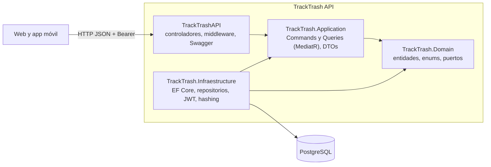
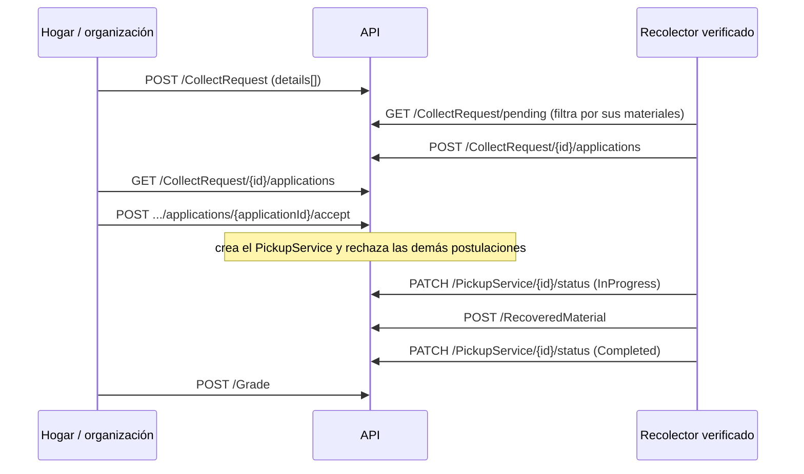

<p align="center">
  
</p>

<p align="center">
  
  
  
  
  
</p>

<p align="center">
  <a href="#funcionalidades">Funcionalidades</a> ·
  <a href="#arquitectura">Arquitectura</a> ·
  <a href="#ejecutar-en-local">Ejecutar</a> ·
  <a href="#despliegue-en-render">Despliegue</a> ·
  <a href="#autenticación">Autenticación</a> ·
  <a href="#permisos-por-rol">Permisos</a> ·
  <a href="#convenciones">Convenciones</a>
</p>

## Sobre el proyecto

**TrackTrash** coordina el recojo de residuos reciclables en Arequipa entre hogares, organizaciones y recolectores
verificados. Este repositorio es la API que comparten la plataforma web y la app móvil.

| Repositorio | Tecnología |
| --- | --- |
| Backend (este repositorio) | ASP.NET Core 10, arquitectura limpia, CQRS con MediatR, EF Core, PostgreSQL |
| [Web](https://github.com/CarlosFloresDev/tracktrash-web) | React, TypeScript, Tailwind CSS |
| [Mobile](https://github.com/CarlosFloresDev/tracktrash-mobile) | Flutter, Riverpod, Dio |

## Funcionalidades

| Módulo | Qué resuelve |
| --- | --- |
| Autenticación | Registro atómico de cuenta y perfil, login con JWT, refresh token rotativo con detección de reutilización, logout que revoca la sesión y `GET /api/User/me` |
| Solicitudes | Un hogar u organización crea la solicitud con sus materiales (`details[]`) en una sola llamada y sigue su historial de estados; cancelarla cancela también su servicio activo |
| Postulaciones | Los recolectores verificados se postulan; el solicitante acepta una (se crea el servicio) y las demás se rechazan |
| Recolectores | Verificación de documentos, materiales que acepta cada recolector y búsqueda de recolectores compatibles por solicitud |
| Servicios de recojo | Inicio, registro de material recuperado, finalización o cancelación, y calificación del servicio |
| Catálogos | Tipos de residuo administrables, ubicaciones y puntos de acopio |
| Indicadores | Kilos recuperados, residuos por tipo y calificaciones de recolectores (solo administrador) |

## Arquitectura



| Proyecto | Contiene | Depende de |
| --- | --- | --- |
| `TrackTrash.Domain` | Entidades, enums, puertos de repositorio, `IUnitOfWork`. Sin paquetes. | Nada |
| `TrackTrash.Application` | Casos de uso (`UseCases/<Area>/Commands` y `Queries`), DTOs, puertos de servicios externos | Domain |
| `TrackTrash.Infraestructure` | `DbContext`, repositorios, servicios (JWT, hashing), registro de dependencias | Domain, Application |
| `TrackTrashAPI` | Controladores, middleware, Swagger, `Program.cs` | Application, Infraestructure |
| `TrackTrash.Tests` | Pruebas xUnit | Todos |

## Ejecutar en local

Requisitos: .NET SDK 10 y PostgreSQL 15 o superior.

1. Crear la base de datos y cargar los scripts en orden:

   ```bash
   createdb tracktrash_db
   psql -d tracktrash_db -f database/01_schema.sql
   psql -d tracktrash_db -f database/03_add_auth_and_applications.sql
   psql -d tracktrash_db -f database/04_seed_residue_types.sql
   psql -d tracktrash_db -f database/05_indicator_views.sql
   ```

   | Script | Contenido |
   | --- | --- |
   | `01_schema.sql` | Tablas, claves e índices, generado desde el modelo de EF Core (`dotnet ef dbcontext script`) |
   | `02_align_neon_api.sql` | Alinea la base compartida en Neon: catálogos de estados y vistas de indicadores. Se niega a correr si ya hay solicitudes |
   | `03_add_auth_and_applications.sql` | Sesiones de refresh token y postulaciones de recolectores |
   | `04_seed_residue_types.sql` | Catálogo inicial de materiales para las categorías fijas `Recyclable`, `Organic` y `General` |
   | `05_indicator_views.sql` | Crea o actualiza las tres vistas de indicadores en PostgreSQL |

   En una base nueva, ejecuta los scripts 01, 03, 04 y 05 en ese orden. El script 02 corresponde a la alineación de catálogos de Neon.

   Los cambios de esquema van en scripts nuevos dentro de `database/`, nunca editando uno ya publicado.

2. Configurar los secretos de desarrollo (no guardarlos en `appsettings.json`):

   ```bash
   dotnet user-secrets set "ConnectionStrings:DefaultConnection" "Host=localhost;Port=5432;Database=tracktrash_db;Username=postgres;Password=<tu-password>" --project TrackTrashAPI
   dotnet user-secrets set "Jwt:Key" "<secreto-aleatorio-de-al-menos-32-bytes>" --project TrackTrashAPI
   ```

   También se pueden pasar como variables de entorno: `ConnectionStrings__DefaultConnection` y `Jwt__Key`.

3. Compilar, probar y ejecutar:

   ```bash
   dotnet build
   dotnet test
   dotnet run --project TrackTrashAPI
   ```

4. Abrir Swagger en `http://localhost:5145/swagger`.

Ejecutar siempre con `dotnet run` o el perfil del IDE. Si se lanza el `.exe` directamente, el entorno no es
`Development`: no se cargan los user-secrets ni se publica Swagger.

La API no crea administradores: se registra la cuenta y se cambia su `role_id` a `1` en la base.

## Despliegue en Render

1. Crear un **Web Service** conectado a este repositorio: rama `main`, runtime **Docker** y **Root Directory** vacío
   para usar el `Dockerfile` de la raíz.
2. En **Environment**, configurar estas variables antes del primer despliegue:

   | Variable | Valor |
   | --- | --- |
   | `ConnectionStrings__DefaultConnection` | Cadena de conexión de PostgreSQL en formato Npgsql, con host, base de datos, usuario, contraseña y configuración TLS de Neon |
   | `Jwt__Key` | Secreto aleatorio de producción de al menos 32 bytes. La API requiere esta clave para arrancar |

3. Pulsar **Deploy Web Service**. El contenedor escucha en el puerto que Render asigna mediante `PORT` (por defecto
   `10000`). Configurar **Health Check Path** con `/api/health`, que responde `{ "status": "ok" }` sin autenticación.

Render vuelve a desplegar automáticamente con cada push o merge a `main`. En el plan gratuito el servicio se suspende
tras unos minutos sin tráfico y la primera petición tarda en despertarlo.

## Autenticación

| Endpoint | Cuerpo | Resultado |
| --- | --- | --- |
| `POST /api/Auth/Register` | Datos de la cuenta, `location` y, según el rol, `organization` o `gatherer` | Crea usuario, dirección y perfil en una transacción; devuelve el id |
| `POST /api/Auth/Login` | `{ "email", "password" }` | `accessToken`, `refreshToken`, `tokenType`, `expiresAt`, `expiresIn`, `refreshAfterSeconds` (1800) |
| `POST /api/Auth/Refresh` | `{ "refreshToken" }` | Un par nuevo; el refresh token anterior queda rotado |
| `POST /api/Auth/Logout` | `{ "refreshToken" }` | Revoca la familia de refresh tokens de esa sesión |
| `GET /api/User/me` | Bearer | Perfil asociado al access token |

- El access token dura 4 horas. El refresh token tiene una vigencia móvil de 7 días desde cada renovación.
- Reutilizar un refresh token ya rotado revoca toda su familia.
- Un access token vencido responde `401` con `code: "ACCESS_TOKEN_EXPIRED"`: el cliente renueva y reintenta.
- `refreshAfterSeconds` indica el intervalo mínimo antes de renovar si el cliente sigue activo.
- Todo exige `Authorization: Bearer <accessToken>` salvo registro (`POST /api/Auth/Register` y `POST /api/User`),
  login, refresh, logout y `GET /api/health`.
  Los ids de usuario de cada operación salen del token y los cambios comprueban la propiedad del recurso.

## Permisos por rol

| Recurso/endpoint | Generator | Organization | Gatherer | Admin |
| --- | --- | --- | --- | --- |
| `GET /api/User/me`, `PUT /api/User/{id}` propio, cambio de password propio | Sí | Sí | Sí | Sí |
| `GET /api/CollectRequest/user/{id}` propio, crear/editar/cancelar solicitud | Sí | Sí | No | Sí |
| `GET /api/CollectRequest/pending`, ver detalle compatible, postularse | No | No | Sí | Consulta completa |
| `GET /api/Gatherer`, perfiles y recolectores compatibles por residuo o solicitud | Sí | Sí | No | Sí |
| Postulaciones de una solicitud: listar, aceptar y rechazar | Propietario | Propietario | Postular y ver propias | Supervisar |
| `PUT /api/Gatherer/me/residue-types` | No | No | Sí | `PUT /api/Gatherer/{id}/residue-types` |
| Perfil del solicitante (`GET /api/CollectRequest/{id}/requester-profile`) | Propio | Propio | Solicitudes visibles | Completo |
| `GET /api/GathererGrade/gatherer/{id}` calificaciones | Sí | Sí | Sí | Sí |
| Historial de solicitud y servicio | Participante | Participante | Participante | Todos |
| Usuarios, reportes, indicadores y datos globales | No | No | No | Sí |
| Gestionar el catálogo `ResidueType` | No | No | No | Sí |

## Flujo de un recojo



Cada elemento de `details[]` lleva `residueTypeId`, `estimatedQuantity`, `unitId` y `observations`. El material debe
existir, estar activo y ser reciclable. Al aceptar una postulación, el recolector tiene que estar activo, verificado
y aceptar todos los materiales de la solicitud. `ResidueCategory` es un enum; `ResidueType` es un catálogo
administrable para no requerir despliegues al agregar materiales.

## Convenciones

- Una rama por módulo: `feature/<modulo>`. Un commit por tarea: `tipo(modulo): descripción`.
- Un archivo por operación: el `record` del Command o Query y su handler `internal sealed`.
- Los handlers lanzan `InvalidOperationException` (400), `KeyNotFoundException` (404) o `UnauthorizedAccessException` (401). `ExceptionHandlingMiddleware` los convierte en la respuesta HTTP.
- Un `InvalidOperationException` que envuelve otra excepción (por ejemplo, un fallo de conexión a la base de datos) se responde como 500 con mensaje genérico, no como 400.
- Los controladores solo envían el mensaje con `ISender`; no llevan `try/catch`.
- Código e identificadores en inglés, sin comentarios.
- `Program.cs`, los `.csproj`, el `DbContext`, los registros de dependencias, el repositorio genérico y `IUnitOfWork` son archivos compartidos: los cambios se piden a quien mantiene la base.

## Pendientes conocidos

Detalle y prioridades en los [hallazgos de integración](https://github.com/CarlosFloresDev/tracktrash-web/blob/main/docs/HALLAZGOS_BACKEND.md):
CORS abierto a cualquier origen, puntos de acopio por
material sin forma de cargarse y listas sin paginación.

---

<p align="center">Proyecto académico de Tecsup Arequipa, 2026.</p>
